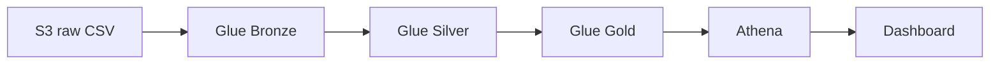

# DataCo Smart Supply Chain & Logística

## 1) Visão Geral
Projeto ponta a ponta com arquitetura Lakehouse Medallion (Bronze/Silver/Gold) utilizando PySpark + Delta Lake para análise de eficiência logística, atrasos e riscos/fraudes na cadeia de suprimentos DataCo.

## 2) Arquitetura Lakehouse

Versão AWS: ver `aws/README_AWS.md` e `docs/architecture/architecture.drawio`.

## 3) Stack Tecnológica
| Tecnologia | Descritivo |
| :-- | :-- |
| **PySpark** | Processamento distribuído para grandes volumes |
| **Delta Lake** | ACID, versionamento, evolução de schema |
| **Pandas** | Apoio à análise exploratória |
| **Streamlit** | Dashboard executivo interativo |
| **Plotly** | Visualizações dinâmicas |
| **Spark SQL** | Consultas analíticas avançadas |

## 4) Dataset
- **Fonte:** [Kaggle - DataCo Smart Supply Chain for Big Data Analysis](https://www.kaggle.com/datasets/shashwatwork/dataco-smart-supply-chain-for-big-data-analysis)
- **Arquivo:** DataCoSupplyChainDataset.csv
- **Tamanho:** ~91.5 MB | **Linhas:** 180.519 | **Colunas:** 53
- **Granularidade:** Por item do pedido (Order Item Id)

## 5) Estrutura do Repositório
```text
DataCo-Smart-Supply-Chain/
├── data/        # raw/bronze/silver/gold
├── docs/        # architecture/mockups/gitkraken
├── logs/        # logs de execução
├── reports/     # inventários e validações
├── src/         # scripts PySpark
├── sql/         # consultas SQL avançadas
├── notebooks/   # EDA e validações
├── dashboard/   # app Streamlit
├── requirements.txt
├── .gitignore
└── README.md
`

## 6) Pré-requisitos
- **Java** 8 ou 11 (obrigatório para Spark)
- **Python** 3.10+
- **PySpark** compatível com sua versão

## 7) Instalação
`ash
python -m venv .venv
# Windows
.venv\Scripts\activate
# Linux/Mac
source .venv/bin/activate

pip install -r requirements.txt
`

## 8) Execução do Pipeline
`ash
# 1) Camada BRONZE
python src/01_bronze_ingest.py

# 2) Camada SILVER
python src/02_silver_transform.py

# 3) Camada GOLD
python src/03_gold_aggregate.py
`

## 9) Dashboard Executivo
`ash
streamlit run dashboard/app.py
`

## 10) Fluxo Git com GitKraken
Branches: main, develop, eature/ingestao-bronze, eature/transformacao-silver, eature/modelagem-gold, eature/consultas-sql, eature/dashboard-torre-controle

Commits semânticos: eat:, docs:, chore:, ix:, 
efactor:

## 11) Próximos Passos
- Finalizar Silver e Gold
- Criar consultas SQL avançadas (impacto financeiro por atraso)
- Implementar dashboard Torre de Controle com KPIs OTIF
- Adicionar mockups em docs/mockups/
- Merge via PR no GitKraken
